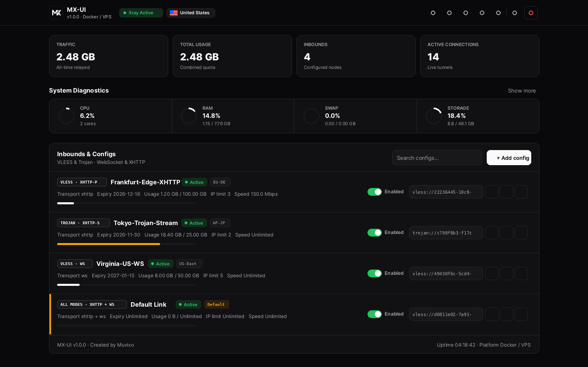

<p align="center">
  
</p>

<h1 align="center">MX-UI v1.0.0</h1>

<p align="center">
  Multi-platform VLESS &amp; Trojan (WebSocket &amp; XHTTP) control plane powered by Xray Core.<br/>
  Built for <strong>Railway</strong>, <strong>Render</strong>, <strong>Lucity</strong>, <strong>Wispbyte</strong>, <strong>Fly.io</strong>, <strong>Koyeb</strong>, <strong>Docker</strong>, and <strong>VPS</strong>.
</p>

---

## Preview

<p align="center">
  
</p>

---

## Key Features

- **Multi-Protocol Xray Core Inbounds**:
  - `VLESS + WebSocket` (`/ws`)
  - `VLESS + XHTTP` (`packet-up` & `stream-up` on `/xhttp`, auto-adapts between `xhttp` and `splithttp`)
  - `Trojan + WebSocket` (`/ws-trojan`)
  - `Trojan + XHTTP` (`packet-up` & `stream-up` on `/xhttp-trojan`)
- **Cross-Region & CDN Ready**:
  - WebSocket keepalive (`ping_interval=25s`) to prevent PaaS load balancers from dropping idle cross-region tunnels
  - Per-config and global **CDN / Edge Host** & **SNI Override** support
  - Curated **Edge IP Pool** assignment (`data/ips.txt`) with concurrent TCP latency probing
- **Universal Multi-Platform Support**:
  - Auto-detects **Railway**, **Render**, **Lucity**, **Wispbyte**, **Fly.io**, **Koyeb**, **Heroku**, **Docker**, and **VPS**
  - Automatic `PORT` / `SERVER_PORT` resolution, `X-Forwarded-Proto` / `X-Forwarded-Host` / `CF-Connecting-IP` handling, and writable `DATA_DIR` fallback (`/data` → `./data`)
- **Modern Responsive Control Plane**:
  - Separated Jinja2 templates (`templates/`) and static assets (`static/css`, `static/js`, `static/img`)
  - Zero external CSS/JS framework dependencies; non-blocking font loading for restricted networks
  - Live system metrics (CPU, RAM, Swap, Storage, Load), active connections viewer, activity logs, local offline QR codes, and JSON database export/import

---

## Project Structure

```text
MXUI/
├── app/
│   ├── config.py              # Multi-platform detection, host/port/TLS & data-dir resolution
│   ├── state.py               # Persistent state, IP limits, link validation & formatting
│   ├── auth.py                # HMAC-signed persistent sessions & password management
│   ├── xray_manager.py        # Xray Core control plane (4 inbounds, stats sync, SIGHUP reload)
│   ├── proxy.py               # WebSocket (with keepalive) & XHTTP reverse proxy
│   ├── links.py               # VLESS & Trojan URI builders (Primary + Edge IP pool)
│   ├── qr_generator.py        # Local offline PNG QR code generator
│   ├── ip_suggest.py          # Cached edge IP loader
│   ├── system_stats.py        # Non-blocking psutil + /proc fallback metrics
│   └── routes/
│       ├── api_auth.py        # Auth, setup, password & custom paths API
│       ├── api_links.py       # Config CRUD, QR, & concurrent health checks
│       ├── api_system.py      # Health, stats, connections, activity, platform & DB export/import
│       ├── sub.py             # Subscription portal, info page & Base64 feeds
│       └── pages.py           # Jinja2 page routes & custom-path catch-all
├── templates/                 # Separated Jinja2 HTML templates
│   ├── base.html
│   ├── login.html
│   ├── setup.html
│   ├── dashboard.html
│   ├── sub_user.html
│   └── sub_info.html
├── static/
│   ├── css/app.css            # Responsive dark obsidian + cyan/teal & light themes
│   ├── js/utils.js
│   ├── js/dashboard.js
│   └── img/
│       ├── mxui-icon.png      # App icon (512x512)
│       └── mxui-icon.svg      # Vector app icon
├── deploy/                    # Multi-platform deployment manifests
│   ├── install_xray.sh        # Cross-platform Xray Core installer (Linux/macOS)
│   ├── start.sh               # Universal startup script
│   ├── render.yaml            # Render Blueprint
│   ├── railway.toml           # Railway config
│   ├── nixpacks.toml          # Nixpacks (Railway, Lucity, Coolify, Dokploy)
│   ├── fly.toml               # Fly.io config
│   ├── Procfile               # Heroku / Dokku / PaaS
│   ├── docker-compose.yml     # Docker Compose for VPS
│   ├── mxui.service           # Systemd unit for bare VPS
│   └── .env.example           # Environment variable template
├── data/
│   └── ips.txt                # Curated edge IP list
├── docs/
│   └── preview.png            # Dashboard preview screenshot
├── main.py                    # FastAPI entrypoint
├── Dockerfile                 # Multi-arch production image (Python 3.11 + Xray v25.1.30)
├── requirements.txt
└── README.md
```

---

## Multi-Platform Deployment

### 1. Railway
- Push to GitHub and deploy using `Dockerfile` (`deploy/railway.toml` is included).
- Mount a persistent volume at `/data` and optionally set `ADMIN_PASSWORD`.

### 2. Render
- Connect your repository using `deploy/render.yaml` (Docker runtime, health check `/health`).
- Set `DATA_DIR=/app/data` (or attach a Render Disk at `/data`).

### 3. Lucity / Coolify / Dokploy (Nixpacks or Docker)
- Supports both `Dockerfile` and `deploy/nixpacks.toml`.
- Set `PUBLIC_HOST` if using a custom domain, or leave empty for automatic `Host` header detection.

### 4. Wispbyte / Container Hosting
- Upload the project and set the startup command to `bash deploy/start.sh` (or `python3 main.py`).
- `PORT` / `SERVER_PORT` and non-443 connection ports are automatically detected; `start.sh` auto-installs Xray into `./bin/xray` if not already present.

### 5. VPS (Bare Metal / Systemd / Docker Compose)
```bash
# Option A: Docker Compose
cd deploy && docker compose up -d --build

# Option B: Bare-metal Ubuntu/Debian
pip install -r requirements.txt
sudo bash deploy/install_xray.sh
bash deploy/start.sh
```
For systemd, copy `deploy/mxui.service` to `/etc/systemd/system/mxui.service`, adjust paths, and run `systemctl enable --now mxui`.

### 6. Fly.io
```bash
fly launch --config deploy/fly.toml
```

---

## Environment Variables

| Variable | Description | Default |
|---|---|---|
| `ADMIN_PASSWORD` | Initial admin password | `MUVIXO` |
| `SECRET_KEY` | Session & token signing secret | Auto-generated in `DATA_DIR` |
| `DATA_DIR` | Persistent state directory | `/data` (falls back to `./data`) |
| `PORT` / `SERVER_PORT` | Public HTTP server port | `8080` |
| `TLS_MODE` | Link TLS mode (`auto`, `tls`, `none`) | `auto` |
| `PUBLIC_HOST` | Explicit public domain or IP override | Auto-detected from headers/env |
| `PUBLIC_CONNECT_PORT` | Override port used in generated client URIs | Auto-detected |
| `CDN_HOST` | Global CDN/Edge host for cross-region routing | – |
| `MXUI_TZ` | Timezone for hourly traffic buckets | `Asia/Tehran` |

---

## Subscription & API Endpoints

- **Health**: `GET /health`, `GET /healthz`, `GET /readyz`
- **Subscriptions**:
  - `GET /sub/user?uuid=<uuid>` — Full user portal with QR code & edge IP links
  - `GET /sub/{uuid}/info` — Compact subscription summary page
  - `GET /sub/{uuid}` — Base64 feed with `Subscription-Userinfo` header
- **Control Plane API** (Authenticated):
  - `GET/POST /api/links`, `PATCH/DELETE /api/links/{uuid}`, `PATCH /api/links/{uuid}/toggle`, `POST /api/links/{uuid}/reset-traffic`
  - `POST /api/configs/test` — Concurrent TCP reachability & latency test
  - `GET /api/connections`, `GET /api/activity`, `GET /api/platform`, `GET /stats`
  - `GET/POST /api/settings`, `GET /api/database/export`, `POST /api/database/import`

---

**Created by Muvixo** · MIT License
